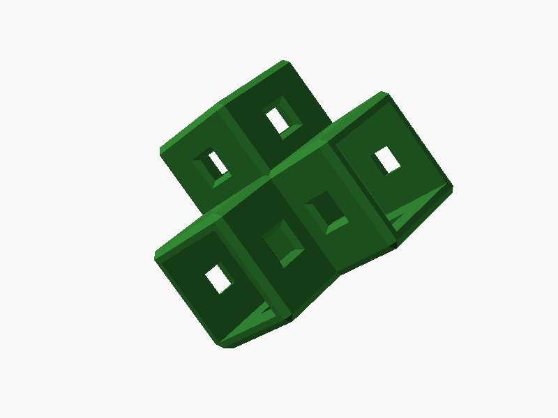
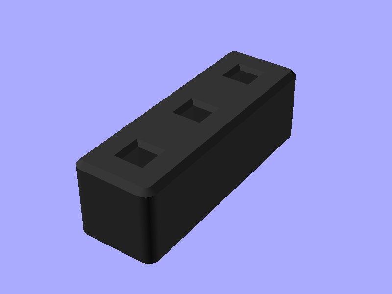
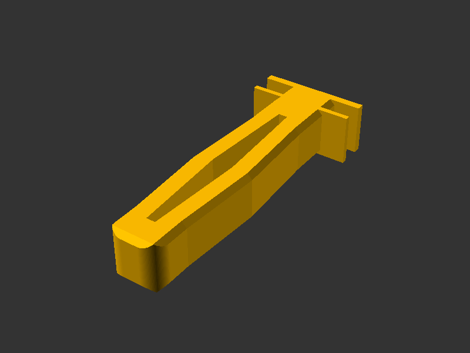

# 🧱 HomeRacker Core

## 📌 What

The core building system for HomeRacker, the fully modular 3D-printable rack-building platform. Provides supports, connectors, and lock pins as parametric OpenSCAD modules.

## 🤔 Why

- **Modularity**: Snap-together system using standardized 15mm units, no glue, no screws
- **Parametric**: Every component is fully customizable via OpenSCAD Customizer
- **Extensible**: Library modules (`lib/`) can be included in your own projects

See the [main README's Tech Specs](../../README.md#-tech-specs) for dimensional rationale and assembly basics.

## 🔧 How

### Using the Library

Include the core library in your OpenSCAD projects:

```scad
use <core/main.scad>

// Create a 3-directional connector
connector(dimensions=3, directions=3);

// Create a support beam (3 units long)
support(units=3);

// Create a lock pin with standard grip
lockpin(grip_type="standard");

// Advanced: use the lock-pin hole primitive directly (e.g. in a split connector)
// disable_chamfer=true produces a flat-ended hole for stacking
lockpin_hole_support(disable_chamfer=false);
```

### 📏 Print Bed Fit

[`lib/print_bed.scad`](lib/print_bed.scad) returns the longest part of a given width that fits a print bed, placed straight or diagonally. Use it to decide whether a part needs a split.

```scad
include <homeracker/models/core/lib/print_bed.scad>

// A 15 mm wide part on an X1C bed
fit = print_fit(bed = bed_size("bambu_x1c"), width = 15);           // [347.04, 45]: length in mm, angle from the bed's X axis
length = max_print_length(bed = bed_size("bambu_x1c"), width = 15); // 347.04
length = max_print_length(bed = [256, 256], width = 15);            // own bed size [x, y]

// Does a 15 x 340 mm part fit an X1C bed, and at which angle?
angle = print_angle(bed = bed_size("bambu_x1c"), width = 15, length = 340); // 45; 0 or 90 when it fits straight, undef when it doesn't fit
```

<details>
<summary>When does diagonal placement pay off?</summary>

On a square bed of side `s`, the diagonal fits `s·√2 − width`, which beats the straight `s` only while `width < s·(√2 − 1) ≈ 0.414·s`. Wider parts get the straight fit at 0°.

| Bed | Diagonal stops helping at width |
|---|---|
| 180 mm (e.g. A1 mini) | ~75 mm |
| 256 mm (e.g. X1C) | ~106 mm |
| 350 mm (e.g. K2 Plus) | ~145 mm |

On rectangular beds the crossover shifts; `print_fit` finds it either way.

</details>

- ⚠️ Results use the pure usable bed with no margin. Leave room for brims and skirts yourself.
- `bed_size` keys (e.g. `bambu_h2c`, `prusa_core_one`) are listed in `PRINT_BEDS`, with sizes taken from the printers' OrcaSlicer profiles.
- Dual-nozzle printers list the area both nozzles reach; `*_single` keys hold the larger left-nozzle area for single-material prints.
- Corner exclusion zones (e.g. 18×28 mm front-left on the X1/P1 series) are ignored. On a square bed, print along the diagonal that avoids them.
- `print_fit` returns `[0, undef]` when nothing fits.
- Nothing here is HomeRacker-specific; the library may move to its own repository. See [the decision record](../../docs/decisions/print-bed-fit-library.md).

### Customizing Parts

Open any file in `parts/` with OpenSCAD and use the **Customizer** panel to adjust parameters:

- **`connector.scad`**: Customize dimensions, directions, pull-through axes, and orientation
- **`support.scad`**: Customize length and hole configurations
- **`lockpin.scad`**: Customize grip type (standard, extended or no-grip)

### Exporting Variants

The `presets/` folder contains modules for batch-exporting all logical variants:

- **`connectors.scad`**: Organized collections (standard, pull-through)
- **`supports.scad`**: Various support lengths with different hole configurations
- **`lockpins.scad`**: Standard grip, extended and no-grip variants

## 🧩 Core Components

### 1. **Supports** (Beams)
Structural elements with standardized connection points.
- 15mm × 15mm cross-section
- Configurable length (multiples of 15mm)
- Optional second set of lock pin holes across the X axis (`x_holes`), the ones a panel mount needs on the face it lies on. The configurator asks for them on every support, see [x-hole supports by default](../../docs/decisions/x-hole-supports-by-default.md)

### 2. **Connectors**
Junction pieces that join supports in multiple directions.
- 1D, 2D, or 3D variants (up to 6 directions)
- Optional pull-through axes for complex builds
- Lock pin holes (4mm square pins)
- Use [foot inserts](../foot/README.md) to create a stable contact interface to the ground

### 3. **Lock Pins**
4mm square pins that secure connectors to supports via tension fit.
- Standard grip: Two grip arms for easy insertion/removal
- Extended grip: Two asymmetric grip arms with a dominant outer arm.
- No-grip variant: Smooth design for minimal profile
- Bidirectional tension hole for secure fit

## 📐 Dimensional Standards

- **Base Unit**: 15mm
- **Lock Pin**: 4mm square
- **Wall Thickness**: 2mm
- **Tolerance**: 0.2mm (built into connectors)
- **Standard Chamfer**: 1mm
- **Lock Pin Chamfer**: 0.8mm

## 📸 Catalog

| Part | Preview |
|------|---------|
| Connector |  |
| Support |  |
| Lock Pin |  |

To generate or refresh previews:

```bash
scadm export-png models/core/parts/<part>.scad
```

## 📝 License

- **Source Code**: MIT License
- **3D Models**: CC BY-SA 4.0

## 📚 References

- [Main Repository](https://github.com/kellerlabs/homeracker)
- [BOSL2 Library Documentation](https://github.com/BelfrySCAD/BOSL2/wiki)
