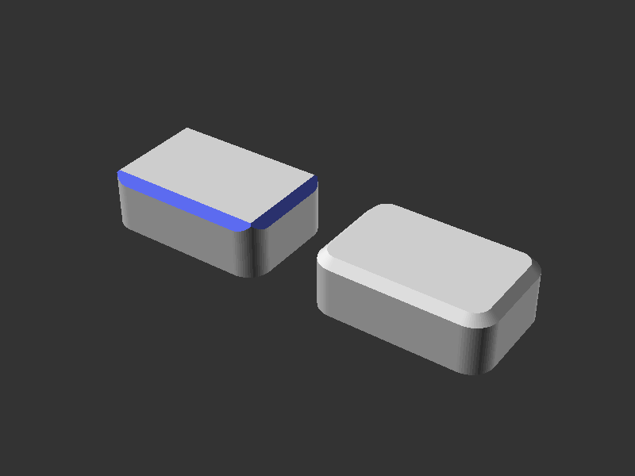
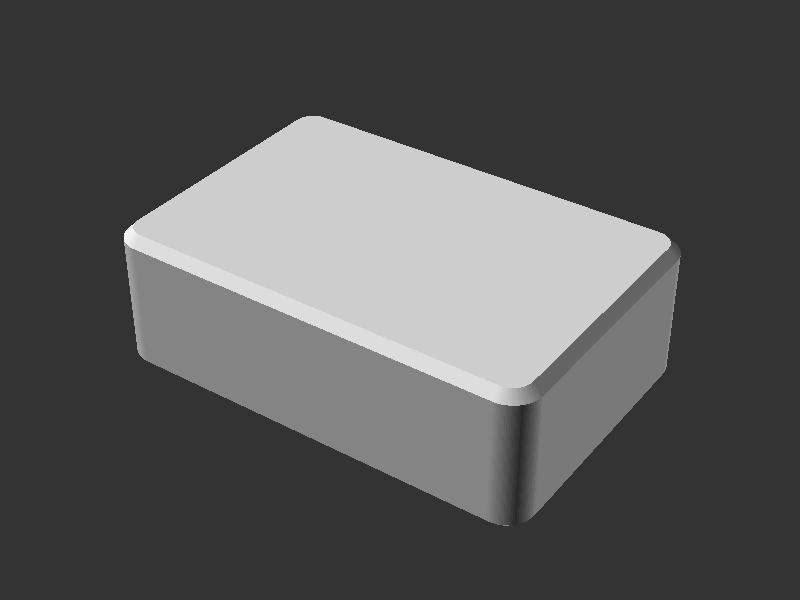
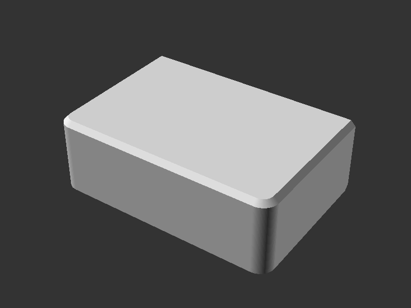

# 🧰 KellerLab Essentials

Generic OpenSCAD utilities KellerLab uses in every model. Nothing here is HomeRacker-specific.

## 🧊 Cuboid

### 📌 What

[`lib/kl_cuboid.scad`](lib/kl_cuboid.scad) provides `kl_cuboid`, a cuboid that rounds the edges along one axis and chamfers the edges of the two faces across it, on one body.

### 🤔 Why

Combining roundings and chamfers on one BOSL2 `cuboid` doesn't work: it refuses both at once, and a chamfer mask on a rounded cuboid cuts a square outline over the rounded corners (left).



The clean result (right) takes an `offset_sweep`, plus a grow-and-clip step whenever only some sides get chamfered:

```scad
// Rounded front corners join front, left and right into one chain; the top chamfer covers it
outline = rect([30, 20], rounding = [0, 0, 3, 3]);
grown = back(1.5, rect([30, 23], rounding = [0, 0, 3, 3]));  // back side grown, so its chamfer lands outside
intersection() {
  linear_sweep(outline, height = 10, center = true);
  offset_sweep(grown, height = 10, top = os_chamfer(width = 1), anchor = "origin");
}
```

`kl_cuboid` does this in one call. Its rule: roundings on the edges along one axis, chamfers on the faces across it. With that axis pointing up on the print bed, every part gets print-optimized edges:

- **Roundings on vertical edges** remove the corner bulge a sharp corner leaves, where the toolhead slows while the nozzle keeps extruding.
- **Chamfers on top and bottom edges**, because a rounding on a horizontal edge prints as visible layer steps.

Caliper readings across 15 mm nominal prints, measured over the corners:

| Print | Vertical edges | Width |
|---|---|---|
| [Cube 0](https://raw.githubusercontent.com/kellerlabs/assets/main/homeracker/models/kl_support/img/bulge_measurement_rounding_0mm.jpg) | sharp | 15.13 mm |
| [Cube 1](https://raw.githubusercontent.com/kellerlabs/assets/main/homeracker/models/kl_support/img/bulge_measurement_rounding_1mm.jpg) | 1 mm rounding | 15.05 mm |
| [Cube 2](https://raw.githubusercontent.com/kellerlabs/assets/main/homeracker/models/kl_support/img/bulge_measurement_rounding_2mm.jpg) | 2 mm rounding | 14.95 mm |
| [Support C](https://raw.githubusercontent.com/kellerlabs/assets/main/homeracker/models/kl_support/img/bulge_measurement_hr_support_chamfered.jpg) | chamfered | 15.08 mm |
| [Support R](https://raw.githubusercontent.com/kellerlabs/assets/main/homeracker/models/kl_support/img/bulge_measurement_hr_support_rounded.jpg) | rounded | 14.98 mm |


⚠️ Five pieces, one each, printed on a Bambu Lab H2C. An X1C showed the same behavior by eye, unmeasured. Other printer brands may differ.

See [the decision record](../../docs/decisions/print-optimized-kl-cuboid.md).

### 🔧 How

```scad
include <homeracker/models/essentials/lib/kl_cuboid.scad>

// All vertical edges rounded, top and bottom chamfered
kl_cuboid([45, 30, 15], rounding = 3, chamfer = 1);

// Front corners rounded; chamfering the top left edge chamfers left, front and right
kl_cuboid([45, 30, 15], rounding = 3, rounding_edges = [FRONT + LEFT, FRONT + RIGHT],
  chamfer = 1, chamfer_edges = [TOP + LEFT]);

// A part printed front face down: rounds along Y, chamfers the front and back faces
kl_cuboid([20, 10, 30], rounding = 2, rounding_edges = [LEFT + TOP],
  chamfer = 1, chamfer_edges = [FRONT + TOP, BACK + LEFT]);
```

- The edges decide the axis: all `rounding_edges` must run along one axis (`LEFT + TOP` runs along Y). Without roundings, a whole-face chamfer (`FRONT`) points along it; otherwise it's Z.
- `chamfer_edges` takes edges on the two faces across the axis or those whole faces. Anything else fails an assertion.
- Leaving out `rounding_edges` rounds all four edges along the axis; leaving out `chamfer_edges` chamfers both faces across it.
- A rounded edge joins its two sides into a chain; a chamfer always covers the whole chain on its face.
- It's a BOSL2 attachable sized like `cuboid`, so `anchor`, `attach` and `align` work as usual.
- ⚠️ A chamfer wider than the rounding radius turns the rounded corner sharp on that face.
- Use masks or plain BOSL2 shapes for anything outside these rules.

[`test/kl_cuboid.scad`](test/kl_cuboid.scad) asserts the chamfer chain rule and the axis inference, and renders one cuboid per case.

### 📸 Catalog

| Part | Preview |
|------|---------|
| Cuboid |  |
| Cuboid, front corners rounded, top left edge chamfered |  |

To generate or refresh previews:

```bash
scadm export-png models/essentials/parts/kl_cuboid.scad
scadm export-png models/essentials/parts/kl_cuboid.scad -D round_back_left=false -D round_back_right=false -D chamfer_top_front=false -D chamfer_top_right=false -D chamfer_top_back=false -D chamfer_bottom_front=false -D chamfer_bottom_right=false -D chamfer_bottom_back=false -D chamfer_bottom_left=false --output models/essentials/parts/renders/kl_cuboid_chain.png
scadm export-png models/essentials/test/kl_cuboid_comparison.scad
```

## 📏 Print Bed Fit

### 📌 What

[`lib/print_bed.scad`](lib/print_bed.scad) returns the longest part of a given width that fits a print bed, placed straight or diagonally. Use it to decide whether a part needs a split.

### 🤔 Why

Long parts need a split when they exceed the print bed, and placed diagonally they fit far beyond the bed's side length. See [the decision record](../../docs/decisions/print-bed-fit-library.md).

### 🔧 How

```scad
include <homeracker/models/essentials/lib/print_bed.scad>

// A 15 mm wide part on an X1C bed
fit = print_fit(bed = bed_size("bambu_x1c"), width = 15);           // [347.04, 45]: length in mm, angle from the bed's X axis
length = max_print_length(bed = bed_size("bambu_x1c"), width = 15); // 347.04
length = max_print_length(bed = [256, 256], width = 15);            // own bed size [x, y]

// Does a 15 x 340 mm part fit an X1C bed, and at which angle?
angle = print_angle(bed = bed_size("bambu_x1c"), width = 15, length = 340); // 45; 0 or 90 when it fits straight, undef when it doesn't fit
```

<details>
<summary>When does diagonal placement pay off?</summary>

On a square bed of side `s`, the diagonal fits `s·√2 − width`, which beats the straight `s` only while `width < s·(√2 − 1) ≈ 0.414·s`. Wider parts get the straight fit at 0°.

| Bed | Diagonal stops helping at width |
|---|---|
| 180 mm (e.g. A1 mini) | ~75 mm |
| 256 mm (e.g. X1C) | ~106 mm |
| 350 mm (e.g. K2 Plus) | ~145 mm |

On rectangular beds the crossover shifts; `print_fit` finds it either way.

</details>

- ⚠️ Results use the pure usable bed with no margin. Leave room for brims and skirts yourself.
- `bed_size` keys (e.g. `bambu_h2c`, `prusa_core_one`) are listed in `PRINT_BEDS`, with sizes taken from the printers' OrcaSlicer profiles.
- Dual-nozzle printers list the area both nozzles reach; `*_single` keys hold the larger left-nozzle area for single-material prints.
- Corner exclusion zones (e.g. 18×28 mm front-left on the X1/P1 series) are ignored. On a square bed, print along the diagonal that avoids them.
- `print_fit` returns `[0, undef]` when nothing fits.

[`test/print_bed.scad`](test/print_bed.scad) asserts `print_fit` against closed-form cases and renders the fitted part on its bed.

## 📚 References

- [BOSL2 `offset_sweep`](https://github.com/BelfrySCAD/BOSL2/wiki/rounding.scad#functionmodule-offset_sweep)
- [Core](../core/README.md), the HomeRacker building system
