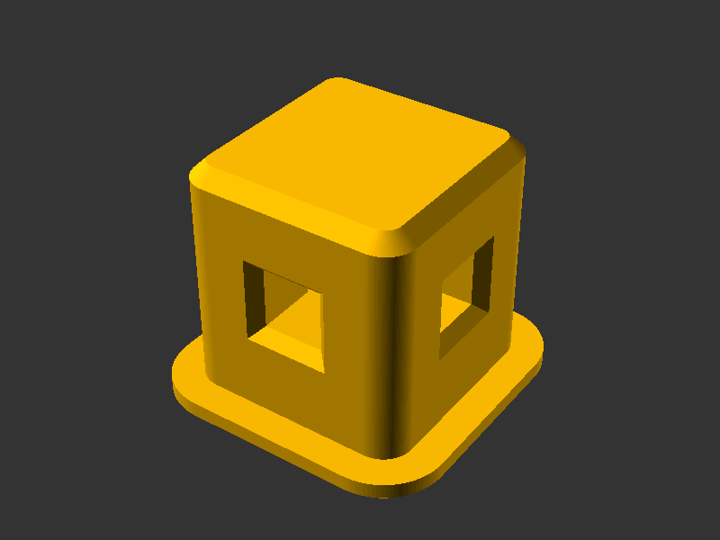

# 🦶 Foot Insert

## 📌 What

A standalone foot insert that plugs into any HomeRacker connector arm from the outside. Replaces the former built-in `is_foot` connector option with a separate, modular component.

## 🤔 Why

- **Flexibility**: Feet are now independent, add or remove them without needing special connector variants. When extending a rack vertically, just unmount the feet and add levels to the bottom.
- **Simplicity**: Removes `is_foot` complexity from the connector module (fewer variants to maintain and export).
- **Material choice**: Can be printed in **TPU** for better grip and load distribution, while the connector stays rigid (PLA/PETG).

## 🔧 How

Open `parts/foot.scad` in OpenSCAD and use the **Customizer** panel.

| Parameter | Default | Description |
|-----------|---------|-------------|
| `debug_colors` | `false` | Show distinct colors per section for visualization |
| `disable_chamfer` | `false` | Remove chamfers from all sections; roundings stay |
| `anchor` | `CENTER` | BOSL2 anchor point for positioning |
| `spin` | `0` | BOSL2 spin rotation (degrees) |
| `orient` | `UP` | BOSL2 orientation vector |

### Geometry

Two stacked [`kl_cuboid`](../essentials/README.md#-cuboid) parts (top → bottom, using BOSL2 `attach()`), both with rounded vertical edges in print orientation:

1. **Plug** (15×15×15.1mm): 2mm roundings like a support, chamfered on top. Plugs into the connector arm with lock pin holes in both perpendicular directions; the extra `TOLERANCE/2` below the holes keeps the plate clear of the arm end.
2. **Base plate** (19.2×19.2×2mm): Wider platform for load distribution and grip. Its 4.1mm rounding runs concentric with the plug's; chamfered on the bottom edges.

### Usage

```scad
include <foot/lib/foot.scad>

// Default foot
foot();

// Debug visualization
foot(debug_colors=true);

// Flat base (no chamfer)
foot(disable_chamfer=true);
```

## 📸 Catalog

| Part | Preview |
|------|---------|
| Foot |  |

To generate or refresh previews:

```sh
scadm export-png models/foot/parts/foot.scad
```

## 📚 References

- [HomeRacker core](../core/README.md): connectors, supports, lock pins
- [Connector module](../core/lib/connector.scad): the connector arms where feet insert
