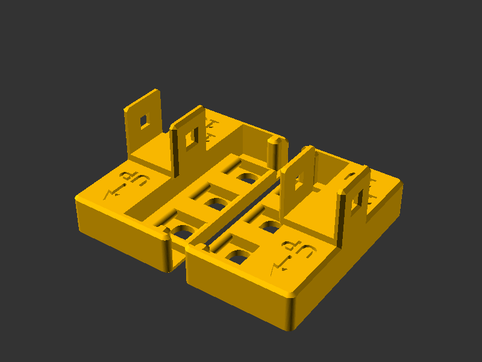
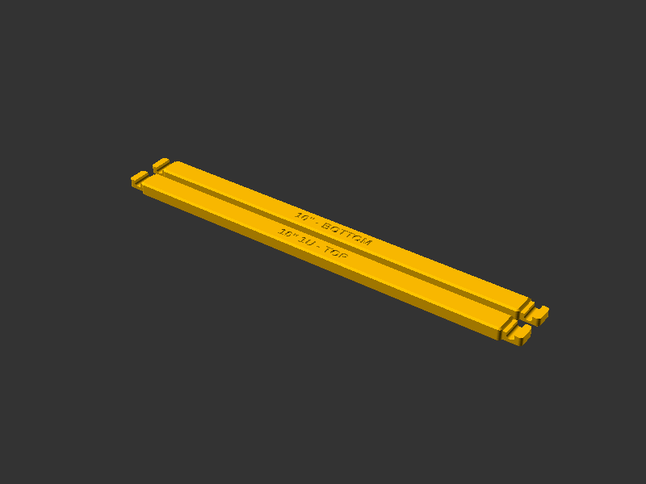

# 🗄️ Rackmount Adapter

> ⚠️ Work in progress: geometry and parameters still change.

## 📌 What

Connects a vertical HomeRacker front support to a standard rack rail. One adapter per rack side, for racks from 2" to 20" wide (10" and 19" are the common ones) and 1 to 10 rack units tall.

From the HomeRacker side to the rack side, each adapter has:

- **Sleeve**: wraps the vertical front support, secured with a lock pin.
- **Mount bridge with connector covers**: covers the connectors above and below the adapter and rests against their arms, which carries the load into the rack.
- **Gap fill**: widens the adapter so the rack rail lands on the standard rack width.
- **Rack rail**: square cage nut holes for M6 cage nuts, three per rack unit, placed per EIA-310 (see [rack standards](rack-standards.md)).
- **End cover docks**: pockets at the top and bottom for end covers that close off the adapter.

Two **end covers** close the rack's top and bottom between the left and right adapter. Each has a tongue at both ends that slides into the docks; the top cover is taller by the gap fill above the top rack unit. An engraved label on the outer face tells them apart: `10" 1U - TOP` on the top cover, `10" - BOTTOM` on the bottom cover, which fits every height. On narrow racks it shrinks to fit, and on 2" racks it shortens to `T` and `B`.

It succeeds the [10"](https://makerworld.com/en/models/1353730-modular-10-server-rack#profileId-1396918) and [19"](https://makerworld.com/en/models/1503491-modular-19-server-rack#profileId-1573137) adapters on MakerWorld.

## 🤔 Why

### 🔁 Replacing the MakerWorld adapters

- Their building blocks aren't open source, and their Fusion 360 source is hard to maintain.
- They mount on Y-axis supports, which needs pull-through connectors, sticks out two units in front of the rack, and forces a bottom-up build where adjoining adapters share a support.
- They only cover 10" and 19", and leave an unclosed gap between adapters.

This adapter mounts on the vertical front supports instead, so any rack level can be swapped later, not just the top one. It sticks out one HomeRacker unit, which leaves room for the front plate and different cage nut sizes without hitting the connector arms of the horizontal supports.

### 📏 Rack units and HomeRacker units

A rack unit is 44.45 mm (1.75", EIA-310). Three HomeRacker units are 45 mm, so every rack unit adds 0.55 mm of gap to the next adapter above.

The adapter is sized for one device. That puts a gap of one HomeRacker unit between adapters, plus the 0.55 mm per rack unit:

- Supports run directly under each device and carry its load, as long as they print in one piece.
- The gap between devices helps heat dissipation.
- Adapters can also be printed tall enough to mount devices directly on top of each other.

### 🧢 End covers slide in from the back

The end cover docks open to the back. An end cover slides in before the adapter goes onto the rack, and the HomeRacker frame behind it holds it in place once mounted, with no extra locking parts.

## 🔧 How

Open `parts/rackmount_adapter.scad` in OpenSCAD and use the **Customizer** panel.

| Parameter | Default | Range | Description |
|-----------|---------|-------|-------------|
| `part` | assembly | assembly, adapters, end covers | The assembled rack front, or a print plate: both adapters front face down, or both end covers inner face down |
| `inches` | 10 | 2-20 | Rack width in full inches |
| `height_units` | 1 | 1-10 | Height in rack units |
| `debug_colors` | false | bool | Color-code geometry for debugging |
| `disable_chamfer` | false | bool | Remove chamfers |
| `debug_anchors` | false | bool | Show the BOSL2 anchors |

- ⚠️ The adapters plate holds a left and a right adapter. Don't mirror an adapter in the slicer: that mirrors the engraved markings too.
- The markings sit on the side that faces the connectors: an up arrow on the top cover, the inch width and rack units on the bottom cover.
- 🔩 Insert the cage nuts before the adapter goes onto the rack. The gap fill next to the rack rail is narrowest on 10" racks (0.5 mm per side, with 7" and 20" close behind), which leaves little room to reach a cage nut once mounted. Any adapter comes off on its own, without taking the rack apart.
- 🔩 Tested with [deleyCON M6 cage nuts](https://www.amazon.de/s?k=deleyCON+M6+K%C3%A4figmuttern) (relaxed hook span 13.58 mm). Cage nuts aren't standardized beyond the 9.5 mm square hole: pick M6 nuts rated for about 2 mm panel thickness. Nuts made for thin panels (under about 1.8 mm, like [RS type N](https://uk.rs-online.com/web/p/cage-nuts/2662268)) may not seat.

**Frame width**: the front horizontal supports need this many HomeRacker units for each rack width (`get_hr_units_by_inches()`):

| Rack | Units | Rack | Units | Rack | Units |
|---|---|---|---|---|---|
| 2" | 4 | 9" | 16 | 16" | 28 |
| 3" | 6 | 10" | 17 | 17" | 29 |
| 4" | 7 | 11" | 19 | 18" | 31 |
| 5" | 9 | 12" | 21 | 19" | 33 |
| 6" | 11 | 13" | 23 | 20" | 34 |
| 7" | 12 | 14" | 24 | | |
| 8" | 14 | 15" | 26 | | |

**Library usage**, include in your own model:

```scad
include <../rackmount_adapter/lib/end_cover.scad>

// left adapter, both end covers, the right adapter on the top cover's other end
rackmount_adapter(rackwidth = 10, height_units = 2) {
  attach("end_cover_top", "end_cover_left") end_cover(rackwidth = 10, height_units = 2, type = END_COVER_TOP)
    attach("end_cover_right", "end_cover_top") rackmount_adapter(rackwidth = 10, height_units = 2, side = RIGHT);
  attach("end_cover_bottom", "end_cover_left") end_cover(rackwidth = 10, height_units = 2, type = END_COVER_BOTTOM);
}
```

Both modules are [BOSL2 attachables](https://github.com/BelfrySCAD/BOSL2/wiki/Tutorial-Attachments). The adapter's `"end_cover_top"` and `"end_cover_bottom"` anchors sit on each dock's front wall; the cover's `"end_cover_left"` and `"end_cover_right"` sit on the matching spot of its tongues. `end_cover_hook` builds the shared tongue shape: the dock subtracts it, the cover adds it with clearance.

## 📸 Catalog

| Part | Preview |
|------|---------|
| Assembly: two adapters with top and bottom end covers |  |
| Print plate: both adapters |  |
| Print plate: both end covers |  |

To generate or refresh previews:

```sh
scadm export-png models/rackmount_adapter/parts/rackmount_adapter.scad
scadm export-png models/rackmount_adapter/parts/rackmount_adapter.scad -D 'part="adapters"' --output models/rackmount_adapter/parts/renders/rackmount_adapter_adapters.png
scadm export-png models/rackmount_adapter/parts/rackmount_adapter.scad -D 'part="end covers"' --output models/rackmount_adapter/parts/renders/rackmount_adapter_end_covers.png
```

## 📚 References

- [Rack standards](rack-standards.md): which rack dimensions the adapter follows, with sources
- [Sleeve](../sleeve/README.md): wraps the vertical front support
- [Rackmount Ears](../rackmount_ears/README.md): mount devices into a standard rack
- [HomeRacker core](../core/README.md): base constants and measurements
